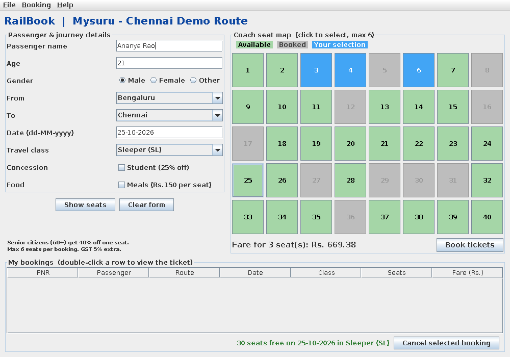
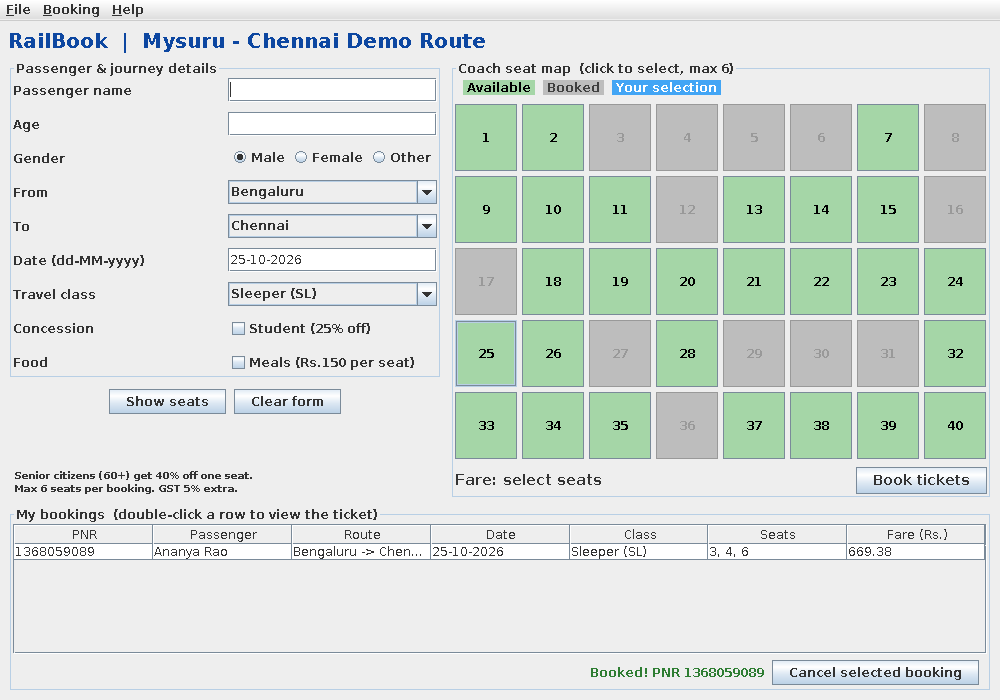
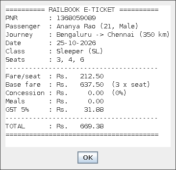
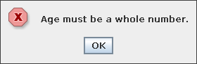
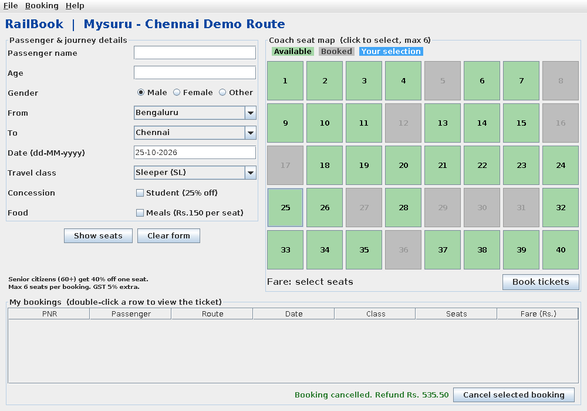

# 🚆 RailBook

A Java Swing desktop app for railway seat reservation — pick your route, click seats on an interactive coach map, and get a printed e-ticket. Built as a mini-project demonstrating core Java OOP and event-handling concepts.

---

## ✨ Feature

- **Interactive seat map** — 40 seats per coach; green = free, grey = booked, blue = your selection (up to 6)
- **Live fare calculator** — updates as you pick seats; applies concessions for senior citizens and students
- **Three travel classes** — Sleeper (SL), AC 3-Tier (3A), AC 2-Tier (2A) with their own rate/km
- **E-ticket generation** — unique PNR, full passenger details, fare breakdown saved to a `.txt` file
- **Cancellation** — frees seats immediately with an 80% refund
- **Input validation** — custom `BookingException` guards every field before a booking is created
- **Menu bar** — File / Booking / Help with keyboard shortcuts

---

## 🛤️ Route

```
Mysuru → Mandya → Bengaluru → Jolarpettai → Katpadi → Chennai
```

---

## 🚀 Getting Started

### Prerequisites

- Java 11 or later (JDK)

### Run in IntelliJ IDEA

1. **New Project** → choose Java, no build system
2. Inside `src`, create a new Java class called `RailBook`
3. Paste / replace with the contents of `RailBook.java`
4. Click the green **Run** arrow

### Run from the terminal

```bash
# Compile
javac RailBook.java

# Run
java RailBook
```

---

## 🗂️ Project Structure

```
RailBook/
├── RailBook.java          # Single-file application (634 lines)
├── screenshots/           # App screenshots
│   ├── rail_1_selecting.png
│   ├── rail_2_after_booking.png
│   ├── rail_3_ticket.png
│   ├── rail_4_error.png
│   └── rail_5_after_cancel.png
└── README.md
```

---

## 📸 Screenshots

| Selecting seats | After booking |
|---|---|
|  |  |

| E-Ticket | Validation error | After cancel |
|---|---|---|
|  |  |  |

---

## 🏗️ OOP Design

| Concept | Where |
|---|---|
| **Abstraction** | `Ticket` is abstract — defines the fare formula but leaves `ratePerKm()` and `reservationCharge()` to subclasses |
| **Inheritance** | `SleeperTicket`, `ThreeTierTicket`, `TwoTierTicket` all extend `Ticket` |
| **Polymorphism** | `createTicket()` returns a `Ticket` reference; `total()` dispatches to the correct subclass at runtime |
| **Encapsulation** | All `Ticket` fields are `private`, exposed only through getters |
| **Custom exception** | `BookingException` (checked) is thrown by input validators and caught in `book()` |

### Layout managers used

| Manager | Where |
|---|---|
| `BorderLayout` | Main window |
| `GridLayout` | Passenger form + seat map grid |
| `FlowLayout` | Button rows |

### Event listeners used

| Listener | Where |
|---|---|
| `ActionListener` | Buttons and menu items |
| `ItemListener` | Class combo-box and checkboxes |
| `KeyAdapter` | Name field (live fare update on key release) |
| `MouseAdapter` | Double-click on booking table to view ticket |
| `WindowAdapter` | Confirm-exit dialog on window close |

---

## 💰 Fare Formula

```
Fare per seat = (distance km × rate/km) + reservation charge

Concession (best single): Senior citizen (60+) = 40%, Student = 25%
Meals = ₹150 per seat
GST = 5% on (subtotal − concession + meals)
```

**Example** — Bengaluru → Chennai (350 km), Sleeper, 2 seats, no concessions:

```
Per seat : 350 × 0.55 + 20 = ₹212.50
2 seats  : ₹425.00
GST 5%   : ₹21.25
Total    : ₹446.25
```

---

## 👥 Team

Team 1 — CMR University, Dept. of CSE

---

## 📄 License

This project is for academic purposes.
